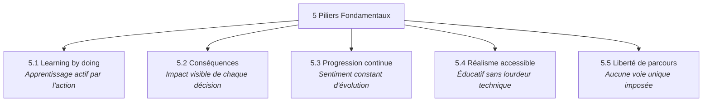
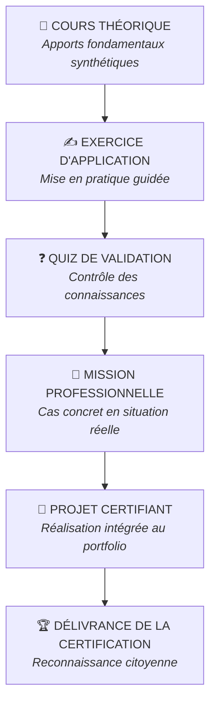
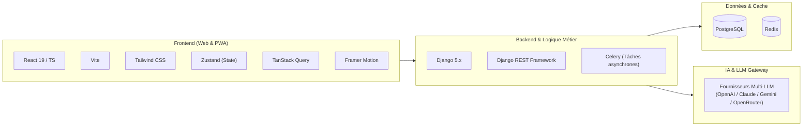
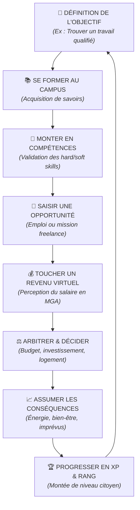

# 🏙️ CAHIER DES CHARGES — YOUTH CITY
> **Plateforme web interactive et gamifiée de simulation de vie et d'apprentissage expérientiel pour jeunes adultes**

---

### 📋 Fiche Signalétique du Projet

| Paramètre | Description |
| :--- | :--- |
| **Nom du projet** | **YOUTH CITY** |
| **Statut du document** | Version de cadrage & spécifications initiales (v1.0) |
| **Cible prioritaire** | Jeunes de 15 à 30 ans (Lycéens, Étudiants, Jeunes actifs, Porteurs de projet) |
| **Typologie** | Plateforme web éducative, simulation de vie, gamification & mentorat IA |
| **Devise principale** | **MGA** (Ariary malgache simulé) |
| **Slogan officiel** | *« Apprends la vie. Construis ton avenir. »* |

---

## 📑 Sommaire Général

1. [Partie I — Vision, Philosophie & Objectifs](#-partie-i--vision-philosophie--objectifs)
   - [1. Présentation générale](#1-présentation-générale)
   - [2. Vision du produit](#2-vision-du-produit)
   - [3. Public cible](#3-public-cible)
   - [4. Objectifs stratégiques & pédagogiques](#4-objectifs-stratégiques--pédagogiques)
   - [5. Philosophie du produit](#5-philosophie-du-produit)
2. [Partie II — Architecture Urbaine & Districts de la Ville](#-partie-ii--architecture-urbaine--districts-de-la-ville)
   - [6. Architecture globale de YOUTH CITY](#6-architecture-globale-de-youth-city)
   - [7. Les quartiers — Campus District](#7-les-quartiers--campus-district)
   - [8. Business District](#8-business-district)
   - [9. Residential District](#9-residential-district)
   - [10. Finance District](#10-finance-district)
   - [11. Market District](#11-market-district)
   - [12. Startup District](#12-startup-district)
   - [13. City Hub](#13-city-hub)
3. [Partie III — Moteur de Jeu, Personnage & Économie](#-partie-iii--moteur-de-jeu-personnage--économie)
   - [14. Le personnage & Attributs](#14-le-personnage--attributs)
   - [15. Système de compétences (Skill Tree)](#15-système-de-compétences-skill-tree)
   - [16. Système XP (Expérience)](#16-système-xp-expérience)
   - [17. Niveaux & Titres citoyens](#17-niveaux--titres-citoyens)
   - [18. Système de gestion du temps](#18-système-de-gestion-du-temps)
   - [19. Énergie, bien-être et équilibre de vie](#19-énergie-bien-être-et-équilibre-de-vie)
   - [20. Système économique & Portefeuille](#20-système-économique--portefeuille)
4. [Partie IV — Activités, Emploi, Projets & Événements](#-partie-iv--activités-emploi-projets--événements)
   - [21. Emploi & Carrière](#21-emploi--carrière)
   - [22. Entretiens d'embauche simulés](#22-entretiens-dembauche-simulés)
   - [23. Éducation & Pipeline pédagogique](#23-éducation--pipeline-pédagogique)
   - [24. Gestion de projets](#24-gestion-de-projets)
   - [25. Système de décisions & Dilemmes moraux/financiers](#25-système-de-décisions--dilemmes-morauxfinanciers)
   - [26. Moteur d'événements dynamiques](#26-moteur-dévénements-dynamiques)
5. [Partie V — Intelligence Artificielle & Mentorat](#-partie-v--intelligence-artificielle--mentorat)
   - [27. IA intégrée & Assistant adaptatif](#27-ia-intégrée--assistant-adaptatif)
   - [28. Personal AI Mentor (NOVA)](#28-personal-ai-mentor-nova)
6. [Partie VI — Dimension Sociale, Portfolio & Career Passport](#-partie-vi--dimension-sociale-portfolio--career-passport)
   - [29. Système social & Coopération](#29-système-social--coopération)
   - [30. Guildes & Communautés thématiques](#30-guildes--communautés-thématiques)
   - [31. Challenges & Missions collaboratives](#31-challenges--missions-collaboratives)
   - [32. Système de badges & Accomplissements](#32-système-de-badges--accomplissements)
   - [33. Classements & Émulation saine](#33-classements--émulation-saine)
   - [34. Portfolio citoyen vérifiable](#34-portfolio-citoyen-vérifiable)
   - [35. Career Passport](#35-career-passport)
7. [Partie VII — Interface, Carte & Expérience Utilisateur (UI/UX)](#-partie-vii--interface-carte--expérience-utilisateur-uiux)
   - [36. Dashboard principal](#36-dashboard-principal)
   - [37. Carte interactive de la ville](#37-carte-interactive-de-la-ville)
   - [38. Conception Responsive & Vision Mobile](#38-conception-responsive--vision-mobile)
8. [Partie VIII — Architecture Technique, Sécurité & Modération](#-partie-viii--architecture-technique-sécurité--modération)
   - [39. Stack technique recommandée](#39-stack-technique-recommandée)
   - [40. Architecture logicielle (Frontend & Backend)](#40-architecture-logicielle-frontend--backend)
   - [41. Modèle de données principal](#41-modèle-de-données-principal)
   - [42. Sécurité & Protection des utilisateurs](#42-sécurité--protection-des-utilisateurs)
   - [43. Modération & Système de signalement](#43-modération--système-de-signalement)
9. [Partie IX — Modèle Économique, Administration & Mesure d'Impact](#-partie-ix--modèle-économique-administration--mesure-dimpact)
   - [44. Modèle de monétisation](#44-modèle-de-monétisation)
   - [45. Back-Office d'administration](#45-back-office-dadministration)
   - [46. Analytics & Indicateurs d'apprentissage](#46-analytics--indicateurs-dapprentissage)
10. [Partie X — Roadmap, Gameplay Loop, UX & Synthèse](#-partie-x--roadmap-gameplay-loop-ux--synthèse)
    - [47. MVP — Minimum Viable Product (Phase 1)](#47-mvp--minimum-viable-product-phase-1)
    - [48. Version 2 — Consolidation & IA Mentor](#48-version-2--consolidation--ia-mentor)
    - [49. Version 3 — Écosystème & Partenariats B2B](#49-version-3--écosystème--partenariats-b2b)
    - [50. Vision à long terme](#50-vision-à-long-terme)
    - [51. Boucle de gameplay fondamentale](#51-boucle-de-gameplay-fondamentale)
    - [52. Scénario illustratif : Une journée type dans Youth City](#52-scénario-illustratif--une-journée-type-dans-youth-city)
    - [53. Facteurs clés de différenciation & Innovations](#53-facteurs-clés-de-différenciation--innovations)
    - [54. Étude comparative : Deux trajectoires citoyennes](#54-étude-comparative--deux-trajectoires-citoyennes)
    - [55. Identité visuelle & Direction artistique](#55-identité-visuelle--direction-artistique)
    - [56. Architecture UX & Parcours utilisateur](#56-architecture-ux--parcours-utilisateur)
    - [57. Principe ergonomique clé : La « Next Action »](#57-principe-ergonomique-clé--la--next-action-)
    - [58. Indicateurs de réussite du projet (KPIs)](#58-indicateurs-de-réussite-du-projet-kpis)
    - [59. Résumé synthétique du produit](#59-résumé-synthétique-du-produit)

---

## 🏛️ PARTIE I — Vision, Philosophie & Objectifs

### 1. Présentation générale

#### 1.1 Nom du projet
**YOUTH CITY**

#### 1.2 Slogan proposé
> **« Apprends la vie. Construis ton avenir. »**

*Autres propositions explorées :*
- *« Ta vie. Tes choix. Ta ville. »*
- *« Joue aujourd'hui. Prépare demain. »*
- *« Construis la vie que tu veux. »*
- *« La ville où tu apprends à devenir adulte. »*

#### 1.3 Concept
**YOUTH CITY** est une plateforme web interactive et gamifiée représentant une ville virtuelle dans laquelle les utilisateurs peuvent simuler différentes situations de la vie réelle.

L'utilisateur commence avec un personnage disposant de ressources limitées et doit progressivement :
- 🧠 **Apprendre** et développer des compétences tangibles ;
- 💼 **Trouver des opportunités** et travailler ;
- 💰 **Gagner de l'argent virtuel** et gérer son budget rigoureusement ;
- 🏠 **Trouver un logement** adapté à ses moyens ;
- 🚀 **Créer des projets** et lancer son entreprise ;
- 🤝 **Développer son réseau** professionnel et social ;
- ⚖️ **Prendre des décisions complexes** et assumer les conséquences de ses choix.

> [!NOTE]
> L'objectif n'est pas de reproduire parfaitement la vie réelle dans ses moindres détails, mais de créer un **environnement d'apprentissage expérientiel** sécurisant et stimulant.

---

### 2. Vision du produit

YOUTH CITY répond à une interrogation centrale :

> *« Et si un jeune pouvait apprendre à gérer sa vie adulte sans risquer de vraies conséquences négatives ? »*

Le produit transforme des concepts abstraits en **expériences concrètes et mesurables**.

#### Exemple concret : Gestion budgétaire
Plutôt que d'expliquer théoriquement qu'*« il faut gérer son budget »*, la simulation met le joueur en situation réelle :

```
┌────────────────────────────────────────────────────────┐
│ 💰 BILAN FINANCIER DU MOIS (MGA)                       │
├────────────────────────────────────────────────────────┤
│ 💵 Salaire perçu          :  + 350 000 MGA            │
│ 🏠 Loyer                  :  - 120 000 MGA            │
│ 🍚 Nourriture             :  -  80 000 MGA            │
│ 📱 Forfait Téléphone/Net  :  -  30 000 MGA            │
│ 🚕 Transport quotidien    :  -  50 000 MGA            │
├────────────────────────────────────────────────────────┤
│ 💡 RESTE À VIVRE          :     70 000 MGA            │
└────────────────────────────────────────────────────────┘
```

Face à ce solde restant, le joueur doit arbitrer :
- 🏦 **Épargner** en cas d'imprévu ?
- 📈 **Investir** dans un actif ?
- 🛒 **Consommer** pour booster son bien-être immédiat ?
- 🎓 **Se former** pour viser un meilleur salaire le mois suivant ?

Chaque choix réoriente dynamiquement la suite de son aventure.

---

### 3. Public cible

#### 3.1 Cœur de cible
Jeunes de **15 à 30 ans**, notamment :
- 🎒 Lycéens en quête d'orientation ;
- 🎓 Étudiants de l'enseignement supérieur ;
- 📜 Jeunes diplômés entrant sur le marché du travail ;
- 💼 Jeunes travailleurs en début de carrière ;
- 🔍 Personnes en recherche d'emploi ou en reconversion ;
- 🚀 Jeunes entrepreneurs et porteurs de projet ;
- 💻 Travailleurs indépendants et freelances ;
- 🧭 Personnes cherchant leur voie professionnelle.

#### 3.2 Utilisateurs secondaires & Partenaires B2B
La plateforme offre des opportunités d'intégration institutionnelle pour :
- Établissements scolaires, lycées et centres de formation ;
- Universités et grandes écoles ;
- Associations d'insertion et ONG jeunesse ;
- Structures d'accompagnement et incubateurs ;
- Entreprises (recrutement, valorisation de métiers) ;
- Organismes publics et privés de formation continue.

---

### 4. Objectifs stratégiques & pédagogiques

#### Objectif principal
Créer un environnement interactif et immersif permettant aux jeunes d'acquérir et perfectionner des compétences clés pour leur vie adulte à travers la simulation.

#### Objectifs secondaires
Développer de façon transversale :
- 📊 **Culture financière** : épargne, budget, crédit responsable, investissement ;
- 🎯 **Orientation professionnelle** : découverte de métiers, tests d'appétence ;
- 💼 **Employabilité** : rédaction de CV, entretiens, soft skills, travail d'équipe ;
- 🚀 **Esprit entrepreneurial** : business model, gestion du risque, vente ;
- ⏳ **Gestion du temps** : organisation, priorisation, équilibre de vie ;
- ⚖️ **Prise de décision & Résolution de problèmes** : esprit critique, anticipation ;
- 🌐 **Compétences numériques** : outils modernes, collaboration en ligne.

---

### 5. Philosophie du produit

Le gameplay et l'architecture de YOUTH CITY reposent sur **5 piliers fondamentaux** :



1. **Learning by doing (Apprentissage par l'action)** : L'apprentissage est toujours issu d'une expérience directe, jamais d'une théorie passive.
2. **Conséquences visibles** : Toute décision (financière, professionnelle, temporelle) engendre des répercussions claires et mesurables.
3. **Progression continue** : Le joueur a toujours un nouvel objectif accessible (palier de compétence, équipement, niveau, opportunité).
4. **Réalisme accessible** : La simulation s'inspire du monde réel tout en conservant une ergonomie intuitive, ludique et gratifiante.
5. **Liberté totale de parcours** : Il n'existe pas de chemin « gagnant ». Salariat, entrepreneuriat, artisanat, recherche : chaque citoyen bâtit son propre modèle de réussite.

---

## 🗺️ PARTIE II — Architecture Urbaine & Districts de la Ville

### 6. Architecture globale de YOUTH CITY

La ville virtuelle est organisée en **7 districts spécialisés**, chacun relié aux mécaniques de vie :

```text
                         ┌─────────────────────────┐
                         │       YOUTH CITY        │
                         └────────────┬────────────┘
                                      │
         ┌────────────────────────────┼────────────────────────────┐
         │                            │                            │
   🎓 CAMPUS                    💼 BUSINESS                  🏠 RESIDENTIAL
   Université / Écoles          Entreprises / Bureaux        Logements / Foyers
   Formations / Certifs         Coworking / Recrutement      Colocations / Quartiers
         │                            │                            │
         └─────────────┬──────────────┴──────────────┬─────────────┘
                       │                             │
                    🏦 FINANCE                    🛒 MARKET
                    Banques / Épargne             Boutiques / Services
                    Crédits / Investissements     Équipement / Loisirs
                       │                             │
                       └──────────────┬──────────────┘
                                      │
                                 🌐 CITY HUB
                                 Événements / Réseau
                                      │
                                🚀 STARTUP
                                Incubateur / Projets
```

---

### 7. Les quartiers — Campus District

#### 7.1 🎓 Campus District : Quartier de l'Éducation
Espace dédié à l'acquisition de savoirs académiques, techniques et pratiques.

**Infrastructures & fonctionnalités :**
- Université et écoles spécialisées ;
- Modules de formations courtes et diplômantes ;
- Bibliothèque de ressources documentaires ;
- Passages d'examens et certifications reconnues dans le jeu ;
- Challenges et hackathons académiques.

#### Exemple de module de formation
```text
┌────────────────────────────────────────────────────────┐
│ 📚 MODULE : DÉVELOPPEMENT WEB FONDAMENTAL              │
├────────────────────────────────────────────────────────┤
│ • Durée requise  : 30 jours virtuels (ou sessions)    │
│ • Coût d'accès   : 50 000 MGA                         │
│ • Compétences    : HTML (+25%), CSS (+25%), JS (+20%) │
│ • Livrable final : Création d'un mini-site web        │
│ • Récompense     : +150 XP & Certificat Junior Web     │
└────────────────────────────────────────────────────────┘
```

---

### 8. 💼 Business District

Quartier d'affaires regroupant les entreprises, startups partenaires et agences de recrutement.

**Infrastructures & fonctionnalités :**
- Sièges d'entreprises locales et multinationales virtuelles ;
- Espaces de coworking ;
- Tableaux d'affichage d'offres d'emploi (stage, CDD, CDI, freelance) ;
- Salles d'entretiens d'embauche assistés par IA.

#### Exemple de fiche de poste
```text
┌────────────────────────────────────────────────────────┐
│ 💼 OFFRE D'EMPLOI : Développeur Web Junior            │
├────────────────────────────────────────────────────────┤
│ • Entreprise     : TechSolutions S.A.                  │
│ • Rémunération   : 450 000 MGA / mois                  │
│ • Prérequis      : JavaScript (≥50%), React, Git       │
│ • Expérience     : 6 mois simulés ou 1 projet validé   │
│ • Impact Énergie : -20 points par journée de travail   │
└────────────────────────────────────────────────────────┘
```

---

### 9. 🏠 Residential District

Espace d'hébergement où le citoyen choisit son cadre de vie selon son pouvoir d'achat.

| Type de logement | Loyer mensuel moyen | Indice Confort / Bien-être | Charges associées |
| :--- | :--- | :--- | :--- |
| **Chambre partagée** | 70 000 MGA | ⭐⭐ *(+10% récup énergie)* | Faibles |
| **Studio individuel** | 150 000 MGA | ⭐⭐⭐ *(+25% récup énergie)* | Moyennes |
| **Appartement F2/F3** | 300 000 MGA | ⭐⭐⭐⭐ *(+45% récup énergie)* | Élevées |
| **Villa résidentielle**| 700 000 MGA | ⭐⭐⭐⭐⭐ *(+70% récup énergie)* | Très élevées |

> [!TIP]
> Un logement de prestige accélère la régénération d'énergie, mais augmente considérablement le point mort financier mensuel.

---

### 10. 🏦 Finance District

Le centre névralgique de l'apprentissage financier.

**Fonctions disponibles :**
- Compte bancaire courant (dépôts, virements, relevés) ;
- Livrets d'épargne avec intérêts simulés ;
- Outil interactif de budgétisation mensuelle ;
- Simulateur de crédit bancaire (emprunt professionnel ou personnel avec tableau d'amortissement) ;
- Initiation aux placements et investissements simulés ;
- Assurances contre les sinistres et aléas de la vie.

> [!IMPORTANT]
> **Règle absolue d'éthique financière** : Tous les mécanismes financiers sont **100 % simulés et pédagogiques**. Aucun dépôt d'argent réel n'est possible ni requis pour progresser dans l'économie du jeu.

---

### 11. 🛒 Market District

Le quartier commercial permettant de subvenir aux besoins de son personnage et de booster son quotidien :
- 🍞 **Alimentation & Produits de première nécessité** (maintien de l'énergie et de la santé) ;
- 👕 **Vêtements & Apparence** (impact sur l'estime de soi et les entretiens professionnels) ;
- 💻 **High-Tech & Matériel professionnel** (smartphones, PC performants nécessaires à certains métiers) ;
- 🛵 **Moyens de transport** (tickets de bus, scooter, voiture : impact direct sur le temps de trajet) ;
- 🛋️ **Mobilier & Décoration** (optimisation du confort du logement).

---

### 12. 🚀 Startup District

Quartier dédié à l'innovation, à l'incubation et à l'entrepreneuriat. Le joueur peut y concevoir, financer et piloter son entreprise virtuelle.

#### Pipeline entrepreneurial
```text
  [ IDÉE & OPPORTUNITÉ ]
            │
            ▼
  [ ÉTUDE DU PROBLÈME & MARCHÉ ]
            │
            ▼
  [ CONCEPTION DU BUSINESS MODEL ]
            │
            ▼
  [ PROTOTYPAGE (MVP) ]
            │
            ▼
  [ ACQUISITION PREMIERS CLIENTS ]
            │
            ▼
  [ GESTION DE TRÉSORERIE & RÉSULTAT ]
            │
            ▼
  [ CROISSANCE & RECRUTEMENT ]
```

**Variables de gestion à piloter :**
- Maîtrise des coûts de structure et charges d'exploitation ;
- Stratégies de communication et marketing ;
- Recrutement et management d'employés virtuels ou de partenaires réels ;
- Satisfaction client et e-réputation de la marque ;
- Gestion stricte du flux de trésorerie (*Cash flow*).

---

### 13. 🌐 City Hub

Le cœur communautaire et événementiel de YOUTH CITY :
- 📅 **Agenda des événements de la cité** (forums de l'emploi, webinaires, salons) ;
- 🏆 **Hackathons & Challenges inter-quartiers** (ex : *Hackathon 48h en équipe de 3 à 5 avec 5 000 XP à la clé*) ;
- 👥 **Groupes d'intérêt et espaces de collaboration** ;
- 📢 **Médiathèque citoyenne et tableaux d'affichage publics**.

---

## 🎮 PARTIE III — Moteur de Jeu, Personnage & Économie

### 14. Le personnage & Attributs

Chaque citoyen crée un avatar unique disposant d'une fiche d'état civil, de jauges physiologiques et de statistiques d'accomplissement.

```text
┌────────────────────────────────────────────────────────┐
│ 👤 PROFIL CITOYEN : Emmanuel                           │
├────────────────────────────────────────────────────────┤
│ 🎖️ Niveau : 17               ⚡ Énergie   : 64%        │
│ ✨ XP Total : 8 450 pts       ❤️ Bien-être : 78%        │
├────────────────────────────────────────────────────────┤
│ 💰 Solde courant  : 125 000 MGA                        │
│ 🏦 Épargne bloquée: 300 000 MGA                        │
├────────────────────────────────────────────────────────┤
│ 📊 Jauges d'Accomplissement :                          │
│   • 🎓 Éducation         : [██████████████░░░] 72%     │
│   • 💼 Employabilité     : [█████████████░░░░] 68%     │
│   • 💰 Maîtrise Finance  : [██████████░░░░░░░] 51%     │
│   • 🚀 Entrepreneuriat   : [████████░░░░░░░░░] 42%     │
│   • 🤝 Capital Social    : [██████████████░░░] 74%     │
└────────────────────────────────────────────────────────┘
```

---

### 15. Système de compétences (Skill Tree)

Les compétences forment l'ossature de la progression du joueur, divisées en 3 piliers :

| Catégorie | Compétences clés simulées | Modalité d'acquisition |
| :--- | :--- | :--- |
| **Soft Skills** | Communication, Leadership, Organisation, Travail d'équipe, Créativité, Résolution de conflits | Missions d'équipe, simulations d'entretiens, choix de dialogue |
| **Hard Skills** | Programmation, Design graphique, Marketing digital, Comptabilité, Gestion, Langues | Cours au Campus, exercices pratiques, projets techniques |
| **Life Skills** | Tenue d'un budget, Négociation de contrat, Cuisine & Nutrition, Gestion du stress, Démarches administratives | Événements quotidiens, gestion du logement, imprévus |

---

### 16. Système XP (Expérience)

Toutes les actions positives rapportent de l'expérience citoyenne permettant de monter en rang :

| Action réalisée | Gain d'XP standard | Bénéfice pédagogique associé |
| :--- | :---: | :--- |
| **Consulter une leçon théorique** | `+10 XP` | Acquisition de notions fondamentales |
| **Réussir un quiz d'évaluation** | `+25 XP` | Validation active des connaissances |
| **Participer à un atelier / événement**| `+50 XP` | Réseau et ouverture citoyenne |
| **Réussir un entretien d'embauche** | `+100 XP` | Maîtrise des codes professionnels |
| **Finaliser un cursus de formation** | `+150 XP` | Certification de hard skills |
| **Terminer et livrer un projet complet**| `+300 XP` | Capacité de concrétisation et portfolio |
| **Entraider un autre joueur (mentorat)**| `+30 XP` | Développement du leadership et partage |

---

### 17. Niveaux & Titres citoyens

| Niveau | Titre officiel | Privilèges & Opportunités débloquées |
| :---: | :--- | :--- |
| **1 - 4** | 🔰 *Nouveau Citoyen* | Accès au Campus de base, logements d'urgence, petits boulots |
| **5 - 9** | 🧭 *Explorateur* | Déblocage des formations intermédiaires, collocations, missions juniors |
| **10 - 19** | 🛠️ *Apprenti / Spécialiste* | Accès aux CDD/CDI en entreprises, création de premiers projets |
| **20 - 29** | 💼 *Professionnel Confirmé* | Postes à responsabilités, accès au crédit bancaire, studio personnel |
| **30 - 49** | 🚀 *Entrepreneur Émérite* | Fondation de startups, embauche d'autres citoyens, investissements |
| **50+** | 👑 *City Builder* | Mentorat de haut niveau, sièges au conseil de la ville, grands projets |

---

### 18. Système de gestion du temps

Pour simuler le défi de l'organisation personnelle, le temps est une ressource finie.

**Deux approches au choix du moteur :**
1. **Temps accéléré temps réel** : 1 journée citoyenne = 15 minutes réelles ;
2. **Cycle par phases journalières (Recommandé pour la flexibilité)** :
   `MATIN` ➔ `APRÈS-MIDI` ➔ `SOIRÉE` ➔ `NUIT`.

#### Allocation du temps quotidien (sur une base de 24h virtuelles)
```text
┌────────────────────────────────────────────────────────┐
│ ⏰ BUDGET TEMPS D'UNE JOURNÉE                          │
├────────────────────────────────────────────────────────┤
│ • Travail / Emploi           :  8 heures               │
│ • Formation au Campus        :  3 heures               │
│ • Sport & Détente            :  1 heure                │
│ • Projet personnel / Side    :  2 heures               │
│ • Déplacements & Intendance  :  2 heures               │
│ • Sommeil réparateur         :  8 heures               │
└────────────────────────────────────────────────────────┘
```

---

### 19. Énergie, bien-être et équilibre de vie

Le personnage dispose d'une jauge d'énergie vitale (0 à 100 %) :

```text
⚡ Énergie : [████████████████░░░░] 82%
```

- **Facteurs d'épuisement** : Travail prolongé, heures supplémentaires, malnutrition, logements inconfortables, manque de sommeil.
- **Facteurs de régénération** : Sommeil complet, alimentation saine achetée au Market, activités sportives, loisirs au City Hub.
- **Impact pédagogique** : Si l'énergie tombe sous les 20 %, la productivité au travail s'effondre, les risques d'accidents augmentent et la note de bien-être baisse.

---

### 20. Système économique & Portefeuille

L'économie tourne exclusivement autour de la devise principale **MGA** (Ariary malgache virtuel).

```text
┌────────────────────────────────────────────────────────┐
│ 💳 PORTEFEUILLE VIRTUEL (YOUTH WALLET)                 │
├────────────────────────────────────────────────────────┤
│ 💵 Solde Disponible       :  250 000 MGA               │
│ 📈 Revenus du mois courant : +450 000 MGA               │
│ 📉 Dépenses engagées       : -320 000 MGA               │
│ 🏦 Épargne de précaution   :  150 000 MGA               │
├────────────────────────────────────────────────────────┤
│ 🛡️ Ratio d'endettement    :  0% (Sain)                 │
└────────────────────────────────────────────────────────┘
```

---

## 💼 PARTIE IV — Activités, Emploi, Projets & Événements

### 21. Emploi & Carrière

Chaque offre d'emploi est adossée à une fiche de compétences techniques et comportementales :

```text
┌────────────────────────────────────────────────────────┐
│ 💼 POSTE : Frontend Developer                          │
├────────────────────────────────────────────────────────┤
│ • Rémunération : 500 000 MGA / mois                    │
│ • Prérequis    : JavaScript (70%), React (50%), Git (40%)│
│ • Portfolio    : Au moins 1 projet fonctionnel validé  │
└────────────────────────────────────────────────────────┘
```

**Parcours de recrutement du joueur :**
1. Consultation de l'offre sur le jobboard du Business District ;
2. Dépôt de candidature (vérification automatique des prérequis) ;
3. Test technique ou étude de cas interactive ;
4. Entretien d'embauche simulé ;
5. Décision d'embauche et signature du contrat virtuel.

---

### 22. Entretiens d'embauche simulés

Grâce au module d'IA, l'utilisateur passe de véritables entretiens interactifs :

```text
┌────────────────────────────────────────────────────────┐
│ 👔 LE RECRUTEUR VIRTUEL                                │
├────────────────────────────────────────────────────────┤
│ « Pourquoi devrions-nous retenir votre candidature     │
│   plutôt qu'une autre pour ce poste chez TechSol ? »   │
└────────────────────────────────────────────────────────┘
                          ▼
               [ Réponse du candidat ]
                          ▼
┌────────────────────────────────────────────────────────┐
│ 🤖 ANALYSE PÉDAGOGIQUE DU MENTOR                       │
├────────────────────────────────────────────────────────┤
│ • Pertinence thématique  : ⭐⭐⭐⭐☆ (8/10)              │
│ • Clarté & Structure     : ⭐⭐⭐☆☆ (6/10)              │
│ • Valorisation des acquis: ⭐⭐⭐⭐☆ (8/10)              │
│                                                        │
│ 💡 Conseil pour progresser :                           │
│   Tu as bien mis en avant tes acquis JavaScript.       │
│   Pense toutefois à illustrer ton propos avec un       │
│   exemple chiffré de projet réalisé.                   │
└────────────────────────────────────────────────────────┘
```

---

### 23. Éducation & Pipeline pédagogique

Chaque cursus de formation suit un entonnoir pédagogique éprouvé assurant la montée en compétences réelles :



---

### 24. Gestion de projets

Le joueur a l'opportunité d'initier ses propres projets transversaux (ex : *Application mobile de livraison de produits locaux*) :
- Choix de l'équipe et association de partenaires ;
- Définition du budget et recherche de financements ;
- Choix de la stack technique ou des méthodes de production ;
- Déploiement de la stratégie commerciale ;
- Simulation des retombées : gain d'XP, revenus additionnels, visibilité.

---

### 25. Système de décisions & Dilemmes moraux/financiers

Le joueur est régulièrement confronté à des dilemmes réalistes :

> **Scénario d'imprévu** : *« Ton ordinateur portable indispensable pour tes études et ton emploi tombe en panne complète. »*

- [Option A] **Acheter un équipement neuf haut de gamme** (Coût : 600 000 MGA — *Épuise l'épargne, mais booste la productivité*) ;
- [Option B] **Faire réparer l'ancien matériel** (Coût : 100 000 MGA — *Économique, mais risque de récidive de 30%*) ;
- [Option C] **Emprunter un PC à un ami citoyen** (Coût : 0 MGA — *Renforce le lien social, mais indisponible le soir*) ;
- [Option D] **Souscrire un crédit bancaire au Finance District** (Mensualités de 35 000 MGA sur 6 mois — *Impact sur le budget récurrent*).

Chaque option entraîne une cascade de conséquences mesurables.

---

### 26. Moteur d'événements dynamiques

La ville génère des événements aléatoires contextualisés selon le profil et l'historique du citoyen :
- Perte ou suspension d'un emploi ;
- Opportunité soudaine de mission freelance bien rémunérée ;
- Concours d'innovation ou hackathon du City Hub ;
- Promotion professionnelle inattendue ;
- Aléas domestiques (panne de chauffe-eau, loyer revu à la hausse) ;
- Rencontre fortuite avec un mentor d'affaires.

---

## 🤖 PARTIE V — Intelligence Artificielle & Mentorat

### 27. IA intégrée & Assistant adaptatif

L'intelligence artificielle n'est pas un simple moteur conversationnel passif : c'est un **coach de vie et de carrière proactif**.

**Exemples d'interventions intelligentes :**
> *« Attention : Tu consacres actuellement 72 % de tes revenus mensuels au loyer et au transport. Un tel ratio fragilise ton épargne. Envisage une colocation ou un mode de transport alternatif. »*

> *« Tes compétences en design UI ont atteint le seuil de 65 %. Deux missions freelance au Business District correspondent exactement à ton niveau. Souhaites-tu postuler ? »*

---

### 28. Personal AI Mentor (NOVA)

Chaque citoyen est guidé par **NOVA**, son compagnon d'apprentissage personnalisé.

```text
┌────────────────────────────────────────────────────────┐
│ 🤖 NOVA — TON MENTOR PERSONNEL                         │
├────────────────────────────────────────────────────────┤
│ Bonjour Emmanuel 👋 ! Voici ton plan d'action du jour :│
│                                                        │
│ [✓] Terminer le module JavaScript (Campus)             │
│ [○] Postuler à 2 offres de stage (Business District)   │
│ [○] Épargner 20 000 MGA sur ton livret de précaution   │
│ [○] Avancer sur le projet de boutique en ligne         │
│                                                        │
│ 💬 Le conseil de NOVA :                                │
│ « Tu as accompli d'excellents progrès théoriques.      │
│   Il est temps de concrétiser cela en publiant un      │
│   premier livrable sur ton portfolio public ! »        │
└────────────────────────────────────────────────────────┘
```

---

## 🌐 PARTIE VI — Dimension Sociale, Portfolio & Career Passport

### 29. Système social & Coopération

Les interactions entre utilisateurs sont pensées pour favoriser l'apprentissage collaboratif et l'émulation positive :
- Liste d'amis et messagerie instantanée ;
- Constitution d'équipes de travail pluridisciplinaires ;
- Partage d'expériences et de recommandations ;
- Co-création d'entreprises virtuelles.

> [!NOTE]
> YOUTH CITY évite les dérives des réseaux sociaux traditionnels : aucune mécanique de scroll infini ni de validation superficielle. Les interactions sociales sont subordonnées à la réalisation de projets et à la progression citoyenne.

---

### 30. Guildes & Communautés thématiques

Les citoyens peuvent rejoindre des guildes professionnelles autonomes :
- 💻 **Developers Guild** (entraide code, revues de projets, hackathons) ;
- 🎨 **Designers Collective** (critiques d'interfaces, défis artistiques) ;
- 🚀 **Entrepreneurs Club** (pitchs, recherche d'associés, partage de business plans) ;
- 📊 **Business & Finance League** (stratégie, comptabilité, investissement) ;
- 🌍 **Social & Green Impact** (initiatives écologiques et associatives).

---

### 31. Challenges & Missions collaboratives

| Type de challenge | Intitulé exemple | Durée | Récompense |
| :--- | :--- | :---: | :--- |
| **Individuel** | *« Bâtir son premier portfolio complet »* | 7 jours | `+100 XP` & Badge Débutant |
| **Collectif** | *« Monter un projet de startup à 3 »* | 30 jours | `+500 XP` & Accès Incubateur |
| **Financier** | *« Réussir à épargner 100 000 MGA »* | 14 jours | `+150 XP` & Titre Épargnant Averti |

---

### 32. Système de badges & Accomplissements

- 🏆 **First Job** : Obtenir son tout premier contrat de travail ;
- 🚀 **Serial Entrepreneur** : Créer une startup générant des bénéfices positifs ;
- 💰 **Smart Saver** : Maintenir 3 mois de dépenses en épargne de sécurité ;
- 🎓 **Scholar** : Valider 5 modules de formation avec mention ;
- 🤝 **Team Player** : Mener à bien un projet collaboratif à 4 ;
- 🔥 **30-Day Streak** : Se connecter et progresser 30 jours d'affilée.

---

### 33. Classements & Émulation saine

Les classements sont **thématiques, hebdomadaires et facultatifs** pour éviter toute compétition anxiogène :
- Classement par compétences acquises ;
- Classement des projets les plus innovants ;
- Classement de la générosité citoyenne (mentorat bénévole) ;
- Classement global d'XP.

---

### 34. Portfolio citoyen vérifiable

Chaque joueur dispose d'un espace vitrine exportable et consultable par des recruteurs réels ou des partenaires :

```text
┌────────────────────────────────────────────────────────┐
│ 🎓 PORTFOLIO PUBLIC : Emmanuel                         │
├────────────────────────────────────────────────────────┤
│ 📚 Formations validées :                               │
│   ✓ Développement Web Frontend (Mention Très Bien)     │
│   ✓ Fondamentaux du Marketing Digital                  │
│                                                        │
│ 🚀 Projets réalisés :                                  │
│   ✓ PrediStock (Outil de prévision des stocks)         │
│   ✓ Portfolio interactif responsive                    │
│                                                        │
│ 💡 Compétences démontrées en pratique :                │
│   • JavaScript (Avancé)    • React (Intermédiaire)     │
│   • Git & GitHub           • Gestion budgétaire        │
└────────────────────────────────────────────────────────┘
```

---

### 35. Career Passport

Véritable CV dynamique nouvelle génération, le **Career Passport** capitalise toutes les actions probantes accomplies sur la plateforme, infalsifiable et orienté vers l'employabilité dans le monde réel.

```text
┌────────────────────────────────────────────────────────┐
│ 🌐 YOUTH CITY — CAREER PASSPORT                        │
├────────────────────────────────────────────────────────┤
│ • Citoyen ID   : #YC-84920                             │
│ • Compétences  : [██████████████░░] 85% d'aptitude pro │
│ • Projets livrés en production : 12                    │
│ • Challenges réussis           : 34                    │
│ • Certifications validées      : 5                     │
│ • Projets d'équipe collaboratifs: 8                    │
└────────────────────────────────────────────────────────┘
```

---

## 🖥️ PARTIE VII — Interface, Carte & Expérience Utilisateur (UI/UX)

### 36. Dashboard principal

Le tableau de bord central propose une synthèse visuelle instantanée de l'état du joueur et de ses priorités.

```text
┌────────────────────────────────────────────────────────────────────────┐
│ 🏙️ YOUTH CITY                      [🔔 Notifications] [👤 Profil]     │
├────────────────────────────────────────────────────────────────────────┤
│ 👋 Bonjour Emmanuel !                                                  │
│                                                                        │
│ 🎯 OBJECTIF EN COURS : Devenir Développeur Junior Web                 │
│ Progression : [████████████████████████░░░░░░░░] 76%                   │
├────────────────────────────────────────┬───────────────────────────────┤
│ 💰 Portefeuille : 425 000 MGA          │ ⚡ Énergie  : 72%              │
│ 🏦 Épargne      : 200 000 MGA          │ ❤️ Bien-être: 81%              │
├────────────────────────────────────────┴───────────────────────────────┤
│ 📅 PLAN D'ACTION DU JOUR (TODAY)                                       │
│   [✓] 09:00 - Cours JavaScript (Campus District)                      │
│   [○] 14:00 - Mission freelance : Intégration maquette                │
│   [○] 18:00 - Challenge d'épargne hebdomadaire                       │
├────────────────────────────────────────────────────────────────────────┤
│ 🤖 CONSEIL DU MENTOR NOVA                                              │
│ « Une entreprise recherche activement un profil correspondant à tes    │
│   compétences React dans le Business District. Prépare ton CV ! »      │
└────────────────────────────────────────────────────────────────────────┘
```

---

### 37. Carte interactive de la ville

La carte permet de naviguer intuitivement entre les 7 districts :

```text
                            🎓 CAMPUS DISTRICT
                            (Écoles & Formations)
                                     │
                                     │
   🏠 RESIDENTIAL DISTRICT ─── 🏙️ CITY CENTER ─── 💼 BUSINESS DISTRICT
   (Logements & Foyer)          (Hub Social)        (Emplois & Coworking)
                                     │
                                     │
                            🏦 FINANCE DISTRICT
                            (Banques & Épargne)
                                     │
                            🚀 STARTUP DISTRICT
                            (Incubateur & Projets)
                                     │
                            🛒 MARKET DISTRICT
                            (Commerces & Équipements)
```

> [!TIP]
> **Orientation MVP** : Une carte vectorielle 2D interactive, cliquable et fluide est largement suffisante et prioritaire par rapport à un monde 3D lourd et complexe.

---

### 38. Conception Responsive & Vision Mobile

L'application est conçue selon l'approche **Mobile-First** :
1. **Smartphone (Priorité N°1)** : Interface optimisée pour écrans tactiles verticaux, navigation par onglets inférieurs ;
2. **Tablette (Priorité N°2)** : Affichage hybride cartes + panneaux latéraux ;
3. **Desktop (Priorité N°3)** : Expérience plein écran avec dashboard étendu.

Une déclinaison en **PWA (Progressive Web App)** garantira une installation instantanée sans passer obligatoirement par les stores d'applications.

---

## ⚙️ PARTIE VIII — Architecture Technique, Sécurité & Modération

### 39. Stack technique recommandée

Afin de garantir robustesse, modernité et pérennité :



- **Frontend** : **React + TypeScript + Vite**, stylisé avec **Tailwind CSS**, gestion d'état avec **Zustand**, requêtage et cache avec **TanStack Query**, et animations fluides avec **Framer Motion**.
- **Backend** : **Python / Django + Django REST Framework** : idéal pour modéliser la riche logique métier (comptes, portefeuilles, compétences, inventaires, progression).
- **Base de données** : **PostgreSQL** (intégrité relationnelle, transactions ACID strictes pour les portefeuilles virtuels).
- **Cache & Asynchronisme** : **Redis** pour les sessions et le calcul des classements en temps réel.
- **Connecteur IA agnostique** : Couche d'abstraction compatible avec les principaux modèles du marché (OpenAI, Google Gemini, Anthropic, OpenRouter) sans dépendance exclusive.

---

### 40. Architecture logicielle (Frontend & Backend)

```text
frontend/
├── app/                  # Configuration racine, routeur et providers
├── components/           # Composants atomiques réutilisables (Boutons, Modales, Inputs)
├── features/             # Organisation modulaire par domaine métier
│   ├── city/             # Carte interactive et navigation entre quartiers
│   ├── character/        # Avatar, statistiques, jauges d'énergie
│   ├── education/        # Cours, quiz, modules du Campus
│   ├── career/           # Emplois, offres, tests de recrutement
│   ├── finance/          # Portefeuille, compte bancaire, budget
│   ├── business/         # Création d'entreprise, startup, clients
│   ├── projects/         # Gestion de projets individuels et d'équipe
│   ├── social/           # Amis, équipes, messagerie, guildes
│   ├── challenges/       # Missions hebdomadaires et classements
│   └── ai/               # Interface de chat et recommandations NOVA
├── hooks/                # Hooks personnalisés
├── services/             # Clients API REST & WebSocket
├── stores/               # Stores globaux Zustand
└── types/                # Types et interfaces TypeScript

backend/
├── core/                 # Configuration générale Django et sécurité
├── users/                # Authentification, profils, permissions
├── characters/           # Modèles de citoyens, statistiques, inventaires
├── city/                 # Bâtiments, quartiers, navigation urbaine
├── skills/               # Arborescence des compétences et validation
├── education/            # Cours, évaluations, certifications
├── careers/              # Entreprises virtuelles, offres d'emploi, candidatures
├── finance/              # Transactions virtuelles, comptes, crédits
├── businesses/           # Entités startups, flux de trésorerie
├── projects/             # Projets créés par les utilisateurs
├── social/               # Amitiés, guildes, invitations
├── challenges/           # Événements, récompenses, XP
└── ai/                   # Orchestration des prompts et appels LLM
```

---

### 41. Modèle de données principal

```text
┌──────────────────────┐         ┌──────────────────────┐
│        User          │ 1     1 │      Character       │
│──────────────────────│─────────│──────────────────────│
│ • id                 │         │ • id                 │
│ • username           │         │ • user_id (FK)       │
│ • email              │         │ • name               │
│ • password_hash      │         │ • level              │
│ • created_at         │         │ • xp                 │
└──────────────────────┘         │ • energy             │
                                 │ • wellbeing          │
                                 │ • money (MGA)        │
                                 └──────────┬───────────┘
                                            │
         ┌──────────────────┬───────────────┼───────────────┬──────────────────┐
         │ 1              * │ 1           * │ 1           * │ 1              * │
┌────────┴─────────┐ ┌──────┴────────┐ ┌────┴────────────┐ ┌┴────────────────┐ ┌┴────────────────┐
│  CharacterSkill  │ │    Property   │ │       Job       │ │    Project     │ │     Event      │
│──────────────────│ │───────────────│ │─────────────────│ │────────────────│ │────────────────│
│ • character_id   │ │ • id          │ │ • id            │ │ • id           │ │ • id           │
│ • skill_id (FK)  │ │ • name        │ │ • title         │ │ • owner_id (FK)│ │ • title        │
│ • level          │ │ • rent_price  │ │ • company       │ │ • name         │ │ • type         │
│ • experience     │ │ • comfort_rate│ │ • salary        │ │ • budget       │ │ • reward_xp    │
└────────┬─────────┘ └───────────────┘ └─────────────────┘ │ • status       │ └────────────────┘
         │ *                                               └────────────────┘
┌────────┴─────────┐
│      Skill       │
│──────────────────│
│ • id             │
│ • name           │
│ • category       │
│ • description    │
└──────────────────┘
```

---

### 42. Sécurité & Protection des utilisateurs

- **Authentification & Droits** : Sessions sécurisées ou JWT (JSON Web Tokens) avec refresh tokens stockés en cookies `HttpOnly` / `SameSite` ;
- **Protection contre les vulnérabilités courantes** : CSRF tokens, sanitization des données, prévention des injections SQL via ORM ;
- **Rate Limiting** : Restriction des requêtes sur les endpoints sensibles (authentification, création de contenu, appels IA) ;
- **Protection des utilisateurs mineurs (15-17 ans)** :
  - Paramètres de confidentialité stricts activés par défaut ;
  - Modération renforcée des messages privés ;
  - Absence totale de mécanismes addictifs de type *gambling* ou *loot boxes*.

---

### 43. Modération & Système de signalement

Pour maintenir un espace bienveillant et constructif :
- Détection automatique par mots-clés et filtres IA contre le spam, le harcèlement, la haine et les contenus inappropriés ;
- Bouton de signalement accessible sur tous les contenus utilisateurs ;
- **Circuit de modération** :
  `Signalement` ➔ `Mise en quarantaine` ➔ `Examen par l'équipe` ➔ `Sanction graduée` (Avertissement ➔ Suspension temporaire ➔ Bannissement définitif).

---

## 📊 PARTIE IX — Modèle Économique, Administration & Mesure d'Impact

### 44. Modèle de monétisation

Le gameplay fondamental est **100 % gratuit** (*Free-to-Learn*).

```text
┌────────────────────────────────────────────────────────────────────────┐
│ MODÈLE FREEMIUM & B2B ÉTHIQUE                                          │
├───────────────────┬────────────────────────────┬───────────────────────┤
│ 🆓 OFFRE GRATUITE │ ⭐ PREMIUM (Optionnel)     │ 🏫 B2B INSTITUTIONS   │
├───────────────────┼────────────────────────────┼───────────────────────┤
│ • Accès à la ville│ • Mentorat IA approfondi   │ • Espaces universitaires│
│ • Tous les cursus │ • Simulations avancées     │ • Tableaux de bord prof│
│ • Emplois de base │ • Analyses statistiques    │ • Challenges privés   │
│ • Mode social     │ • Personnalisations visuelles│ • Licences écoles/ONG │
└───────────────────┴────────────────────────────┴───────────────────────┘
```

---

### 45. Back-Office d'administration

Les gestionnaires de la plateforme disposent d'une console d'administration pour :
- Piloter le catalogue des formations et certifications ;
- Configurer les offres d'emploi virtuelles et ajuster les équilibres économiques ;
- Créer et programmer les événements de la ville et les challenges ;
- Modérer les comptes et analyser les flux de signalements ;
- Superviser les métriques globales de rétention et de succès éducatif.

---

### 46. Analytics & Indicateurs d'apprentissage

Plutôt que d'optimiser le simple temps passé à l'écran, YOUTH CITY mesure la **valeur éducative produite** :
- Taux de complétion des modules de formation ;
- Volume de projets tangibles finalisés ;
- Évolution moyenne de la compétence budgétaire des citoyens ;
- Taux de réussite aux entretiens d'embauche simulés ;
- Taux de conversion vers des candidatures professionnelles réelles.

---

## 🚀 PARTIE X — Roadmap, Gameplay Loop, UX & Synthèse

### 47. MVP — Minimum Viable Product (Phase 1)

> [!IMPORTANT]
> Pour garantir une mise sur le marché rapide et maîtrisée, la Phase 1 se concentre sur la boucle essentielle :

```text
[ AUTHENTIFICATION ]
         │
         ▼
[ CRÉATION DU PERSONNAGE ]
         │
         ▼
[ CARTE 2D DES QUARTIERS ]
         │
         ▼
[ CAMPUS : 1 FORMATION TYPE (ex : Dev Web) ]
         │
         ▼
[ ACQUISITION DE COMPÉTENCES ]
         │
         ▼
[ POSTULATION BUSINESS DISTRICT ]
         │
         ▼
[ PERCEPTION DU PREMIER SALAIRE ]
         │
         ▼
[ GESTION DU BUDGET & LOGEMENT ]
         │
         ▼
[ PREMIÈRE DÉCISION / DILEMME ]
         │
         ▼
[ MONTÉE DE NIVEAU (XP) ]
```

---

### 48. Version 2 — Consolidation & IA Mentor
- Déploiement complet du **Mentor IA NOVA** avec conseils personnalisés quotidiens ;
- Module de création et de gestion de **Startups et Projets** ;
- Système de **Portfolio exportable** ;
- Moteur d'**événements dynamiques et imprévus** ;
- Système d'amitié et challenges hebdomadaires.

---

### 49. Version 3 — Écosystème & Partenariats B2B
- Lancement des **Guildes professionnelles** et hackathons multijoueurs ;
- Déploiement officiel du **Career Passport** vérifiable ;
- Espaces partenaires B2B pour universités, lycées et incubateurs ;
- Application mobile native et mode hors-ligne partiel.

---

### 50. Vision à long terme

À terme, YOUTH CITY a l'ambition de devenir :
> **Le métavers éducatif de référence, léger, accessible et engageant, accompagnant chaque jeune vers son autonomie et sa réussite dans la vie adulte.**

---

### 51. Boucle de gameplay fondamentale



---

### 52. Scénario illustratif : Une journée type dans Youth City

```text
08:00 — ☀️ RÉVEIL DU PERSONNAGE
        • État : Solde = 500 000 MGA | Énergie = 80%
        • Petit-déjeuner au logement : +5% bien-être

09:00 — 🎓 SESSION DE FORMATION AU CAMPUS
        • Module : « Algorithmique & JavaScript » (Durée : 2h)
        • Bilan : +50 XP, Énergie -15%

12:00 — 💼 MARCHÉ DU TRAVAIL & OPPORTUNITÉ
        • Événement : TechSolutions publie une offre Junior.
        • Compétences encore insuffisantes (manque 15% en React).
        • Arbitrage : Continuer l'apprentissage plutôt que postuler prématurément.

15:00 — 💻 MISSION FREELANCE DISPONIBLE
        • Mission : Création d'une page d'atterrissage pour un commerce local.
        • Réalisation validée en 2h.
        • Gain immédiat : +100 000 MGA, +40 XP.

18:00 — 🏠 GESTION DU LOGEMENT & DÉPENSES
        • Paiement de la facture d'électricité : -25 000 MGA.
        • Rangement et repos.

20:00 — 🤖 BRIEFING DU MENTOR NOVA
        • Message : « Bravo pour ta mission freelance ! Ton portfolio compte
          désormais un nouveau livrable. Demain, nous attaquerons React. »

BILAN DE LA JOURNÉE :
  ✨ XP : +290 pts  |  💵 Trésorerie : +75 000 MGA nets  |  🧠 JavaScript : +4%
```

---

### 53. Facteurs clés de différenciation & Innovations

1. **Life Simulation Engine** : Un moteur systémique où chaque paramètre de vie (santé, budget, compétences, réputation) s'influence mutuellement.
2. **AI Life Mentor (NOVA)** : Un coach intelligent qui ne se contente pas de répondre à des requêtes, mais analyse proactivement les vulnérabilités et les forces du joueur.
3. **Skill Passport par la preuve** : Les compétences ne sont pas déclaratives, mais attestées par la réussite de projets et de missions concrètes.
4. **Dynamic Life Events** : Des centaines de ramifications narratives garantissant que deux joueurs ne vivront jamais exactement la même aventure.

---

### 54. Étude comparative : Deux trajectoires citoyennes

```text
┌──────────────────────────────────────┬──────────────────────────────────────┐
│ 🧑 JOUEUR A : Profil Startup & Tech   │ 👩 JOUEUR B : Profil Entreprise & Mgt │
├──────────────────────────────────────┼──────────────────────────────────────┤
│ 1. Études courtes ciblées au Campus  │ 1. Cycle universitaire complet       │
│ 2. Missions Freelance précoces       │ 2. Stage en grande entreprise        │
│ 3. Lancement d'une Startup au Hub    │ 3. Poste de Chef de Projet junior    │
│ 4. Prise de risque financier élevée  │ 4. Épargne rigoureuse & stabilité    │
│ 5. Rôle final : Entrepreneur Tech    │ 5. Rôle final : Manager / Consultante│
└──────────────────────────────────────┴──────────────────────────────────────┘
```

> [!NOTE]
> Aucun des deux parcours n'est jugé supérieur à l'autre. La plateforme valorise la cohérence des choix, la gestion des risques et l'apprentissage tiré des échecs temporaires.

---

### 55. Identité visuelle & Direction artistique

- **Ambiance générale** : Moderne, jeune, chaleureuse, lumineuse et légèrement futuriste ;
- **Style graphique** : Illustration isométrique ou vectorielle semi-stylisée (évocation d'un croisement harmonieux entre *SimCity*, une application néobanque type *Revolut* et une plateforme comme *Duolingo*) ;
- **Palette chromatique** : Tons bleus nuit profonds, blanc pur, avec des touches vives d'émeraude (succès financier), d'ambre (énergie) et de violet électrique (technologie et IA).

---

### 56. Architecture UX & Parcours utilisateur

#### Navigation principale sur Desktop
`🏙️ Ma Ville` | `🎯 Missions` | `📚 Campus` | `💼 Carrière` | `🚀 Projets` | `💰 Finances` | `🤝 Social` | `🤖 NOVA` | `👤 Profil`

#### Barre de navigation inférieure sur Mobile
```text
┌────────────────────────────────────────────────────────┐
│   🏙️          🎯          💼          🤖          👤   │
│  Ville      Missions    Carrière     NOVA       Profil │
└────────────────────────────────────────────────────────┘
```

---

### 57. Principe ergonomique clé : La « Next Action »

Pour éviter tout égarement du joueur dans la richesse de la simulation, le système affiche en permanence un composant universel :

```text
┌────────────────────────────────────────────────────────┐
│ 🎯 PROCHAINE ACTION CONSEILLÉE                         │
├────────────────────────────────────────────────────────┤
│ Finalise le quiz sur les bases budgétaires au Campus   │
│ Récompense garantie : +75 XP & +15% Compétence Finance │
└────────────────────────────────────────────────────────┘
```

---

### 58. Indicateurs de réussite du projet (KPIs)

- **Engagement & Progression** : Nombre de formations finalisées par citoyen par trimestre ;
- **Autonomie financière simulée** : Proportion d'utilisateurs maintenant un ratio d'épargne positif après 3 mois virtuels ;
- **Impact réel perçu** : Enquêtes semestrielles mesurant la confiance des jeunes dans leurs démarches réelles (recherche d'emploi, gestion budgétaire, orientation).

---

### 59. Résumé synthétique du produit

```text
                               YOUTH CITY
                                   │
              ┌────────────────────┼────────────────────┐
              │                    │                    │
           🎓 LEARN             💼 WORK              🚀 BUILD
         Formations &          Emplois &            Startups &
         Compétences           Carrières             Projets
              │                    │                    │
              └────────────────────┼────────────────────┘
                                   │
                              💰 FINANCE
                                   │
                              ⚖️ DÉCISIONS
                                   │
                              📈 CONSÉQUENCES
                                   │
                              🏆 PROGRESSION (XP)
                                   │
                              🤖 MENTORAT IA
                                   │
                              🌍 CITOYEN ACCOMPLI
```